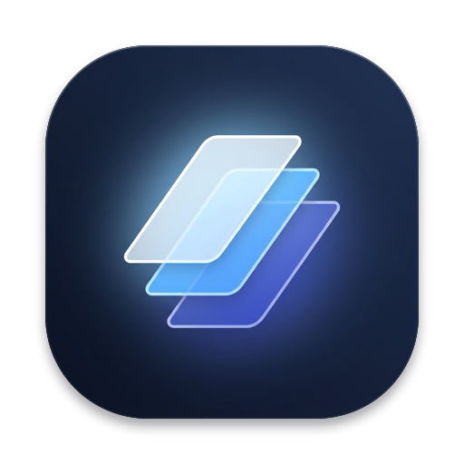

<p align="center">
  
</p>

<h1 align="center">SpaceBoot</h1>

<p align="center">
  Lightweight native macOS Spaces workspace launcher and switcher.<br>
  Record your multi-display, multi-Space window layouts once and boot them on demand — without disabling SIP.
</p>

<p align="center">
  <a href="https://github.com/Interfish/SpaceBoot/actions/workflows/ci.yml"></a>
  <a href="https://github.com/Interfish/SpaceBoot/releases/latest"></a>
  
  
  
  <a href="LICENSE"></a>
</p>

---

## Why SpaceBoot?

macOS native Spaces work well day to day, but rebooting, switching monitor setups (e.g., dual-monitor desk vs. standalone laptop), or restarting apps wipes out carefully arranged Spaces and window frames.

**SpaceBoot** is a pure-Swift menu bar app that works directly with **native macOS Spaces**:

- **Zero-Switch Layout Recording** — Snapshots all connected displays, their non-empty Desktop, native Fullscreen, and Split View Spaces (including vertical split divider ratios), and every open window's frame and z-order without switching away from your current Space.
- **Event-Driven Workspace Boot** — Cold-launches missing apps in parallel up front, relocates windows onto their target Spaces across displays, restores native Fullscreen and Split View pairings with their split ratios, and returns control quickly while continuing to watch slow or login-gated apps in the background.
- **Post-Boot Settle Guard** — Detects apps (such as Electron/Chromium windows) that recenter or swap startup/splash windows after launch, keeping them anchored to their recorded frames and Spaces.
- **Generic, Zero-Hardcoding Launching** — Uses standard LaunchServices for cold launches, inspects `AXMenuBar` to trigger localized *New Window* menu items for warm multi-window launches, and supports custom login-shell commands in profile JSON.
- **Customizable Runtime Global Hotkeys** — Fast `⌥1`–`⌥9` Space switching across displays (with coalesced burst stepping) and `⌥⇧B` to boot the profile matching your currently connected displays. Per-profile hotkey ordering is editable via drag-and-drop and leaves zero permanent entries in System Settings.
- **No SIP Disabling, No Tiling Overhead** — Works on stock macOS with System Integrity Protection enabled and keeps macOS's native window management intact.

---

## Requirements

- **macOS 14.0 (Sonoma)** or later (Apple Silicon & Intel universal binary)
- **Xcode Command Line Tools** (only needed if building from source: `xcode-select --install`)

---

## Installation

### Download a Release

1. Download `SpaceBoot-<version>-universal.dmg` (recommended) or `SpaceBoot-<version>-universal.zip` from [GitHub Releases](https://github.com/Interfish/SpaceBoot/releases).
2. Open the `.dmg` and drag `SpaceBoot.app` into **Applications** (or unzip the `.zip` and move `SpaceBoot.app` into `/Applications`).
3. Because release builds are ad-hoc signed rather than Apple-notarized, macOS may block the first launch. Either **right-click → Open** in Finder, or run:

```bash
xattr -dr com.apple.quarantine /Applications/SpaceBoot.app
open /Applications/SpaceBoot.app
```

### Build from Source

```bash
git clone https://github.com/Interfish/SpaceBoot.git
cd SpaceBoot
make install
open /Applications/SpaceBoot.app
```

To build, install, and immediately launch (or restart) SpaceBoot in one step:

```bash
make run
```

---

## First-Time Setup

1. **Grant Accessibility Permission**
   Click the SpaceBoot icon in the menu bar and select **Grant Accessibility Permission…** (or open **System Settings → Privacy & Security → Accessibility** and enable **SpaceBoot**). This is required to switch Spaces and position windows.
2. **Allow Notifications**
   The first time SpaceBoot posts a notification (such as when recording or booting a profile), macOS asks whether SpaceBoot may send notifications. Allow notifications to see status banners when an action finishes.
3. **Recommended macOS Spaces Settings**
   Open **Optimize macOS Spaces Settings…** from the SpaceBoot menu to disable two Dock defaults that otherwise interfere with predictable Space ordering:
   - *Automatically rearrange Spaces based on most recent use* (`com.apple.dock mru-spaces = false`)
   - *When switching to an application, switch to a Space with open windows* (`com.apple.dock workspaces-auto-swoosh = false`)
4. **Mission Control Shortcuts**
   SpaceBoot dynamically reads your configured Mission Control shortcuts from `com.apple.symbolichotkeys.plist`. Ensure either **Move left / right a space** (enabled by default in macOS) or **Switch to Desktop 1…N** shortcuts are enabled in **System Settings → Keyboard → Keyboard Shortcuts → Mission Control**.

---

## Usage

### Menu Bar Actions

| Action | Description |
| --- | --- |
| **Spaces (Hotkey Order)** | Lists live Desktop Spaces in your active `⌥1`–`⌥9` order; click any Space to jump directly. |
| **New Profile & Record…** | Captures all connected displays, non-empty Spaces (Desktop, Fullscreen, Split View), and open windows into a named JSON profile. |
| **Boot Profile (Launch & Arrange)** | Launches missing apps/windows and places every window on its recorded Space and frame. |
| **Restore Open Windows Only** | Repositions currently open windows without launching closed apps. |
| **Record Current Layout (Overwrite)** | Updates an existing profile while preserving custom `launch` overrides and hotkey order. |
| **Edit Hotkey Order…** | Opens a drag-and-drop floating window to customize the profile's `⌥1`–`⌥9` Space order. |
| **Edit Profile JSON…** | Opens the profile JSON in your default editor for fine-tuning or custom launch commands. |

### Global Keyboard Shortcuts

| Shortcut | Action |
| --- | --- |
| `⌥1` – `⌥9` | Switch directly to Space 1–9 in your configured hotkey order |
| `⌥⇧B` | Automatically find and boot the profile matching currently connected displays |

Global hotkeys are registered at runtime only (via Carbon `RegisterEventHotKey`) and can be toggled on or off from the menu bar at any time.

### Profile Storage & JSON Schema

Profiles and settings are stored under `~/.config/spaceboot/`:

```text
~/.config/spaceboot/
├── profiles/
│   └── dual-monitor.json
├── hotkey-order.json
└── spaceboot.log
```

Each window entry in a profile supports an optional `launch` recipe:

```json
{
  "appId": "com.google.Chrome",
  "appName": "Google Chrome",
  "titleHint": "GitHub",
  "frame": { "x": 0, "y": 25, "width": 1440, "height": 900 },
  "zIndex": 0,
  "launch": {
    "kind": "app",
    "target": "/Applications/Google Chrome.app",
    "url": "https://github.com"
  }
}
```

Supported `launch.kind` values:

- `"app"` — Cold-launches `target` via LaunchServices (with optional `url`) or triggers the running app's *New Window* menu item via Accessibility.
- `"command"` — Runs `target` in your login shell (`$SHELL -l -c "<command>"`), ideal for opening specific IDE workspaces, terminal layouts, or scripts.

### Automation / CLI Triggers

SpaceBoot listens for `DistributedNotificationCenter` notifications named `com.spaceboot.command` so you can trigger actions from scripts, Raycast, Alfred, or Hammerspoon:

```bash
# Supported payloads: "boot:<profile>", "restore:<profile>", "record:<profile>", "switch:<1-9>", "inspect"
swift -e '
import Foundation
DistributedNotificationCenter.default().post(
    name: Notification.Name("com.spaceboot.command"),
    object: "boot:dual-monitor"
)
'
```

---

## Development & Building

SpaceBoot uses **Swift Package Manager** (`Package.swift`) with a thin wrapper script (`scripts/build.sh`) and `Makefile` for `.app` bundling, code signing, installation, and release packaging.

```bash
make build       # Build release SpaceBoot.app into ./build/
make debug       # Build debug SpaceBoot.app into ./build/
make universal   # Build universal (arm64 + x86_64) SpaceBoot.app into ./build/
make install     # Build and install into /Applications (override with INSTALL_DIR=...)
make run         # Build, install, and (re)launch SpaceBoot.app
make package     # Build universal .dmg and .zip archives + .sha256 checksums in ./build/
make icon        # Regenerate Resources/AppIcon.icns and docs/icon.png
make clean       # Remove build/ and .build/
```

For full control (custom version, output path, or signing identity), invoke `scripts/build.sh` directly:

```bash
./scripts/build.sh --help
```

### Code Signing & Accessibility Persistence

macOS ties Accessibility (TCC) permissions to an app's code signature. By default, `scripts/build.sh` looks for an `Apple Development:` identity in your Keychain so you do not have to re-grant Accessibility after every local rebuild, and falls back to ad-hoc signing (`-`) when no certificate is present.

You can override signing explicitly:

```bash
make build CODESIGN_IDENTITY="-"                                  # Force ad-hoc signing
make package CODESIGN_IDENTITY="Developer ID Application: ..."    # Sign for distribution (enables Hardened Runtime)
```

### Releasing

Pushing a SemVer tag (`v*`, e.g. `v0.1.0`) triggers [the Release workflow](.github/workflows/release.yml) on GitHub Actions to build, verify, and publish Universal `.dmg`, `.zip`, and `.sha256` assets to GitHub Releases:

```bash
git tag -a v0.1.0 -m "Release v0.1.0"
git push origin v0.1.0
```

---

## Architecture

| File | Responsibility |
| --- | --- |
| `Sources/AppDelegate.swift` | Menu bar UI, global hotkey dispatch, IPC handler, profile action orchestration |
| `Sources/BootSession.swift` | Event-driven boot pipeline: staggered cold launch, cross-Space placement, background watcher, settle guard |
| `Sources/ProfileManager.swift` | Profile persistence, zero-switch multi-Space recording, pre-boot display/Space validation |
| `Sources/SpaceInspector.swift` | Read-only SkyLight & CoreGraphics queries for displays, Spaces, and genuinely open windows |
| `Sources/WindowController.swift` | Native Space navigation, cross-display bounce relocation, verified AX frame & z-order placement |
| `Sources/AppLauncher.swift` | Universal LaunchServices cold launch, localized `AXMenuBar` *New Window* trigger, login-shell runner |
| `Sources/HotKeyManager.swift` | Runtime-only Carbon global hotkeys (`⌥1`–`⌥9`, `⌥⇧B`) |
| `Sources/HotkeyOrderStore.swift` | Per-profile and live hotkey ordering persistence + drag-and-drop editor window |
| `Sources/SymbolicHotKeys.swift` | Reads user Mission Control shortcuts from `com.apple.symbolichotkeys.plist` |
| `Sources/StatusBarIcon.swift` | Vector CoreGraphics menu bar template icon + busy animation frames |
| `Sources/NotificationService.swift` | Native `UNUserNotificationCenter` delivery using SpaceBoot's own App Icon |
| `Sources/Models.swift` | Profile JSON schema, runtime snapshot types, and configuration constants |
| `Sources/Logger.swift` | Lightweight rotating log writer (`~/.config/spaceboot/spaceboot.log`) |

---

## Notes & Limitations

- **Single-display vs. multi-display Space relocation**: macOS provides no public API to move an existing window between Spaces on the same display without disabling SIP. When two or more displays are connected, SpaceBoot moves windows across Spaces cleanly by briefly bouncing them through a helper display. On a single display, SpaceBoot switches to each target Space before launching its apps so windows open directly where they belong.
- **Private read-only SkyLight queries**: SpaceBoot uses read-only `SkyLight.framework` symbols (`SLSCopyManagedDisplaySpaces`, `SLSCopySpacesForWindows`, `SLSCopyWindowsWithOptionsAndTags`) solely to inspect which Desktop Spaces exist and which windows are open on inactive Spaces. Because private macOS APIs can change across major OS releases, SpaceBoot degrades gracefully and logs diagnostics if a symbol is unavailable.

---

## License

SpaceBoot is released under the [MIT License](LICENSE).
